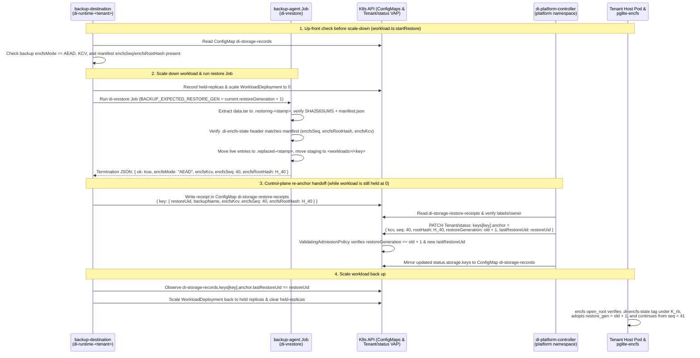

# Design: rollback and replay protection for codec-4 directories (#538)

| | |
|---|---|
| Issue | #538 (split from #200 O2 / Q14 non-goals, refs #497) |
| Roadmap | v0.2 #679, epic E4 #497, lane T04, milestone `#538:design`, decision gate `D02` |
| Status | **Design.** Owner decisions `O1`–`O4` for gate `D02` and engineering decisions `Q1`–`Q8` are recorded in section 8 with concrete recommendations. No code changes; implementation waits for this note to merge and `D02` to be decided. |
| Related | #200 (`docs/design-200-two-slot-aead.md`, codec 4 two-slot AEAD and durable-size watermark), #492 (`backup-agent` PostgreSQL data-directory discovery), #553 (`status.storage.keys` records and backup/restore mode enforcement) |
| Crate | `platform/pglite-encfs`; platform anchor and restore coordination also touch `platform/platform/src/tenancy`, `platform/backup-agent`, and `platform/backup-destination` |

All `file:line` references are relative to `platform/pglite-encfs/` unless they start with `platform/`. They were checked against `origin/main` `1f9f56c`.

## 1. Summary

Codec 4 (#200) authenticates every 8 KiB unit slot and maintains a two-page authenticated durable-size watermark `D` per file, so it detects random corruption, bit flips, cross-file or cross-unit splicing, and unit erasure below `D`. By design (`docs/design-200-two-slot-aead.md` §3 "Non-goals", O2 / Q14), codec 4 alone cannot detect **rollback or replay**: a party with write access to the host volume can replace an entire directory, an individual file, a watermark record, or a single unit's winning slot with an older authentic copy written under the same key, and every tag check passes.

This note designs **rollback protection for codec-4 (`Mode::Integrity`) directories**:

- **Zero format break in codec-4 files.** A 32-byte directory rollback key `K_rb` is derived from the master key (`DI_PGLITE_KEY`) via HKDF-SHA256 with the existing salt `"di-framework/encfs/v1"` (`src/keys.rs:37`) and info `"codec4-rollback"`, alongside a per-file slot-commitment key `mac_key` derived from each file's 64-byte DEK under info `"codec4-rollback-mac"` (`src/slots.rs:117-132`, reserved in `design-200` §5.1). Existing codec-4 headers, watermark record pages, and unit slot pairs do not change by a single byte.
- **Per-directory authenticated state manifest (`.di-encfs-state`).** Each integrity directory maintains a hidden, two-slot crash-safe manifest `.di-encfs-state` at the preopen root, sealed with XChaCha20-Poly1305 under `K_rb`. At a strictly monotonic directory sequence number `seq` (`u64`), the manifest commits to the canonical map of every live regular file in the directory (`relative_path -> (file_id, logical_size, physical_pairs, wm_seq, durable_units, file_slot_digest)`) and chains the previous manifest digest (`prev_root_hash`). Binding `relative_path` to `file_id`, `logical_size`, `wm_seq`, and `file_slot_digest` closes whole-directory rollback, whole-file replacement or deletion, cross-path file moves, pair-aligned truncation, watermark record replay, and single-unit slot regression.
- **External monotonic anchor (`Tenant.status.storage.keys[key].anchor`).** Because an on-disk manifest alone can be rolled back together with the data files, its `(kcv, seq, rootHash, restoreGeneration)` tuple is anchored outside the volume in `Tenant.status.storage.keys[key].anchor` and mirrored into the `di-storage-records` ConfigMap in `di-runtime-<tenant>`. The existing cluster-scoped `tenants/status` ValidatingAdmissionPolicy (`platform/platform/src/tenancy/admission.ts:358-416`) enforces that `anchor.seq` never decreases (and `anchor.rootHash` never changes at equal `seq`) unless `anchor.restoreGeneration` increments by 1 during an authorized restore.
- **Threat model (`T1` vs `T2`).** Under **Model T1** (a volume writer / storage-layer attacker who can read and write the host volume or revert storage snapshots, without compromising the running tenant host pod or Kubernetes control plane), rollback protection is cryptographically complete up to the last anchored epoch. Under **Model T2** (where the tenant host pod itself is also compromised), the attacker holds `DI_PGLITE_KEY` in pod memory and can encrypt arbitrary new state at higher sequence numbers while live, so no in-pod key can prevent live forgery; however, the control-plane admission policy on `tenants/status` still prevents regressing `anchor.seq` across pod restarts.
- **PostgreSQL write-pattern cost.** Synchronous out-of-band network RPCs on every `wasi:filesystem` `sync-data` are incompatible with WASI 0.2's capability boundary (no network imports in `pglite-encfs`), Kubernetes API server write throughput (`initdb` issues >1,700 syncs; OLTP issues one `sync-data` per commit), and fail-stop availability (A3). Instead, `.di-encfs-state` is updated locally on disk (at checkpoint / `pg_control` sync and namespace mutations, with per-file slot digests carried in the lazy watermark record page at zero extra `fsync` cost), and anchored externally by the `storage-mode` init step at every host pod start (with an optional periodic non-blocking controller witness while the pod runs).
- **Legitimate backup restore (#492 / #553) vs rollback attack.** An uncoordinated restore of an older backup (`seq_backup < anchor.seq`) would fail the anchor check as `RollbackDetected`. To distinguish a legitimate restore from an attack without trusting anything on the volume, `backup-agent` verifies and reports the backup's `(encfsSeq, encfsRootHash)` from `manifest.json`, `backup-destination` writes a restore receipt in `di-runtime-<tenant>`, and the platform controller increments `anchor.restoreGeneration` and re-anchors `status.storage.keys[key].anchor` to `(encfsSeq, encfsRootHash)` before `backup-destination` scales the workload back up.

---

## 2. Problem and current state

### 2.1 What codec 4 (#200) already guarantees

In an integrity directory (`Mode::Integrity`, selected by a keyed `DIPGKEY2 ‖ KCV ‖ 0b01` root marker in `.di-encfs`, `src/marker.rs:38-60`), codec 4 already enforces five invariants:

1. **Per-slot AEAD binding (`src/slots.rs:124-151`, `src/slots.rs:188-209`, `src/slots.rs:475-493`).** Every 8 KiB logical unit `u` owns a pair of 8256-byte physical slots (`Slot::A` and `Slot::B`) at `12288 + u × 16512` (`src/slots.rs:58-60`, `src/slots.rs:100-103`). Each slot is sealed with XChaCha20-Poly1305 under `SlotKeys.slots` (`HKDF-SHA256(ikm = DEK, salt = "di-framework/encfs/v1", info = "codec4-aead")`, `src/slots.rs:64`, `src/slots.rs:117-132`) using a fresh 192-bit random nonce and AAD:
   ```text
   AAD = "DIPGENC4" ‖ file_id (16) ‖ unit (u64 LE) ‖ slot (u8: 0=A, 1=B) ‖ generation (u64 LE) ‖ len (u32 LE) ‖ reserved (12 zero bytes)
   ```
   A volume writer without the key cannot flip plaintext bits, forge a slot, swap Slot A and Slot B, move a slot to another unit or another file (`file_id`), or alter `generation` or `len` (`src/slots.rs:768-792`).
2. **Per-file authenticated durable-size watermark `D` (`src/slots.rs:56-60`, `src/slots.rs:324-365`, `src/slots.rs:496-511`).** Two 64-byte watermark records sit at the start of their own 4 KiB pages (`RECORD_AT = [4096, 8192]`), sealed over an empty plaintext under `SlotKeys.records` (`info = "codec4-watermark"`, `src/slots.rs:65`) with AAD:
   ```text
   AAD = "DIPGWM04" ‖ file_id (16) ‖ record_index (u8: 0 or 1) ‖ seq (u64 LE) ‖ durable_units (u64 LE) ‖ reserved (8 zero bytes)
   ```
   The valid record with the higher `seq` establishes `D = durable_units`. Any unit `u < D` inside the host file that has neither a valid Slot A nor a valid Slot B fails with `Integrity::Erased { unit }` (`src/slots.rs:216`, `src/slots.rs:425`, `src/slots.rs:456`), mapped to `ErrorCode::Io`.
3. **Wrapped per-file DEK and codec authentication (`src/header.rs:7-26`, `src/header.rs:131-197`).** Page 0 (`0..4096`) holds the 152-byte `DIPGENC1` header wrapping the 64-byte random `DEK` under `Kek` (`HKDF-SHA256(ikm = master, salt = "di-framework/encfs/v1", info = "kek")`, `src/keys.rs:37-39`, `src/keys.rs:111-125`) with bytes `0..32` (including `codec = 4` and `file_id`) as AAD. `File::cipher` (`src/component.rs:441-452`) refuses any XTS file (`codec` 2 or 3) inside a `Mode::Integrity` directory.
4. **Live-instance in-memory change detection (`src/writer.rs:541-585`, `src/writer.rs:663-691`).** While an `encfs` instance holds `FileState` in memory, `known` tracks which slot (`A` or `B`) won for each touched unit. If a subsequent read or write resolution (`resolve`) finds that the cached winning slot no longer authenticates under `open_slot`, `changed_underneath` returns `Integrity::Changed { unit }` (`src/slots.rs:224-225`), clears `synced_once`, and logs that the volume changed under `encfs`.
5. **Immutable platform mode record (`platform/platform/src/tenancy/storage-records.ts:22-28`, `platform/platform/src/tenancy/admission.ts:358-416`).** Once the `storage-mode` init step (`platform/platform/src/tenancy/storage-mode.ts:39-171`) observes a directory as `aead` or `reserved`, the controller records `status.storage.keys[key].mode = 'AEAD'`, enforced by the `tenant-storage-records` ValidatingAdmissionPolicy on `tenants/status` (`platform/platform/src/tenancy/admission.ts:358-416`) and checked before and during every backup restore (`platform/backup-destination/src/workload.ts:1398-1418`, `platform/backup-agent/src/volume.ts:726-737`).

### 2.2 What codec 4 does NOT detect without an external anchor

Because every authenticator in codec 4 is self-contained within its own slot, watermark record, or file header — and because crash recovery intentionally falls back to the other valid slot or record when a newer write is torn — an attacker with write access to the underlying volume can mount three classes of rollback and replay attacks without triggering any error:

| Attack class | What the volume writer does on disk | Why codec 4 accepts it today | PostgreSQL impact |
|---|---|---|---|
| **R1. Whole-directory rollback (snapshot revert)** | Replaces the entire `<workloads>/<key>` directory (or reverts the underlying host disk / LVM / ZFS / EBS / PVC snapshot) with an earlier point-in-time copy of the same directory. | `.di-encfs` still holds `DIPGKEY2 ‖ KCV ‖ 0b01`; `storage-mode` reports `aead`, matching `status.storage.keys[key].mode = 'AEAD'`; every file header, watermark record, and slot tag is authentic under `DI_PGLITE_KEY`. | Every transaction committed after the snapshot silently disappears ("lost update" / history rewrite), violating durability after `COMMIT` was acknowledged to external clients. |
| **R2a. Whole-file rollback or cross-time splice** | Replaces one file (e.g. `data/global/pg_control`, a WAL segment `data/pg_wal/00000001...`, a clog file `data/pg_xact/0000`, or a relation segment `data/base/16384/16385`) with an older copy of the same file (`file_id`). | The older file has the same `file_id`, a valid header, valid watermark records, and valid slots for its own earlier state. Nothing binds one file's version to another file's version. | Replacing `pg_control` + `pg_wal` while leaving newer heap pages (or vice versa) breaks PostgreSQL LSN and MVCC invariants: committed rows become invisible, uncommitted/aborted rows become visible if `pg_xact` is rolled back, or WAL redo corrupts pages whose LSNs are ahead of the replayed WAL. |
| **R2b. File deletion, injection, or cross-path swap** | Unlinks an existing file (e.g. relation segment `.1` or a WAL segment), plants an old deleted codec-4 file from the same key into the directory, or moves file X to path Y (`design-200` §3 "Binding files to paths"). | `Header` and `Slot` AAD bind to `file_id` (`src/header.rs:144`, `src/slots.rs:135-144`), never to the relative path or to the directory's set of live files. | Unlinking a relation segment or WAL file causes missing data or mid-query `ENOENT`; swapping two relation files of the same cluster returns valid decrypted rows from the wrong table. |
| **R2c. Pair-aligned file truncation** | Truncates a codec-4 file at any pair boundary `12288 + k × 16512` for `k < D` (`design-200` §3 "Truncation"). | `pairs_present(physical)` (`src/slots.rs:107-109`) only counts pairs present in the host file; `size_below` (`src/slots.rs:418-429`) walks `0..pairs_present(physical)`, so absent pairs are never `Integrity::Erased`, even when `k < D` (`design-200` §5.3). | Silently drops trailing 8 KiB pages of a table, index, or WAL segment. |
| **R3a. Single-unit slot regression (corrupting or replaying a slot)** | For unit `u` where Slot A holds durable generation `g` and Slot B holds newer durable generation `g + 1`, the attacker zeroes/corrupts Slot B (or overwrites Slot B with an earlier saved ciphertext of Slot B from generation `g - 1`). | `select` (`src/slots.rs:294-320`) verifies the higher claimed generation first; when Slot B fails authentication (or claims `g - 1 < g`), `select` falls back to Slot A (`generation = g`) because a crash-torn write to Slot B looks identical (`design-200` §3, §5.5, §7 C2/C13). Even on a warm `FileState` cache (`src/writer.rs:541-556`), if the attacker replaces the cached winning slot (`Slot::B`) with an *older authentic ciphertext* for `(file_id, unit, Slot::B, g - 1)`, `open_slot` checks only `generation != 0` (`src/slots.rs:198`), so `open_slot` succeeds and returns the old page without triggering `Integrity::Changed`! | Selectively reverts an individual 8 KiB heap page, index page, `pg_control`, or WAL tail page to its previous synced version while the rest of the database stays at the newer state. |
| **R3b. Watermark record regression** | Corrupts the newer watermark record page (`seq = s + 1, D = D_2`) or overwrites it with an older valid watermark record (`seq = s - 1`), then zeroes both slots of units in `D_1..D_2`. | `select_watermark` (`src/slots.rs:350-365`) falls back to the other valid record (`seq = s, D = D_1`), treating the damaged record as a torn lazy watermark write (`design-200` §7 C15). Units in `D_1..D_2` are now `>= D_1`, so zeroed pairs read as 8192 zeros (`src/slots.rs:455`) or are dropped as trailing pairs (`src/slots.rs:424`). | Lowers `D` to `D_1` and erases durable pages in `D_1..D_2` without triggering `Integrity::Erased`. |

Closing R1, R2a–c, and R3a–b requires two things working together:

1. **An on-disk per-directory cryptographic commitment (`.di-encfs-state`)** that binds the set of live paths in the directory to each file's `file_id`, `logical_size`, winning watermark `(wm_seq, D)`, and per-unit winning slot states `(slot, generation, len, tag)`, under a strictly monotonic directory sequence number `seq`.
2. **An external anchor stored outside the volume** (`Tenant.status.storage.keys[key].anchor`) so that rolling back `.di-encfs-state` together with the directory is detected against the platform's monotonic high-water mark.

---

## 3. Cryptographic root and on-disk manifest (zero format break)

### 3.1 HKDF key derivation without format changes

`design-200` §5.1 chose HKDF-SHA256 with the shared salt `HKDF_SALT = b"di-framework/encfs/v1"` (`src/keys.rs:37`) specifically so rollback protection keys could be derived from the existing master key and per-file DEKs without changing the 152-byte file header (`src/header.rs:7-18`), the 25-byte `.di-encfs` root marker (`src/marker.rs:38-45`), the 64-byte watermark records (`src/slots.rs:56-59`), or the 8256-byte unit slots (`src/slots.rs:48-55`).

The key hierarchy extends `src/keys.rs:3-8` and `src/slots.rs:117-132` with two domain-separated HKDF info strings:

```text
master (32 bytes, env DI_PGLITE_KEY, base64)
  └─ HKDF-SHA256(salt = "di-framework/encfs/v1")
       ├─ info "kek"             → Kek.cipher (XChaCha20-Poly1305, wraps 64-byte file DEKs)
       ├─ info "key-check-value" → 16-byte KCV in file headers, .di-encfs, and .di-encfs-state
       └─ info "codec4-rollback" → Kek.rollback (XChaCha20-Poly1305 key K_rb, seals .di-encfs-state)

file DEK (64 bytes, unwrapped from a codec-4 file header)
  └─ HKDF-SHA256(salt = "di-framework/encfs/v1")
       ├─ info "codec4-aead"         → SlotKeys.slots (XChaCha20-Poly1305, seals unit slots)
       ├─ info "codec4-watermark"    → SlotKeys.records (XChaCha20-Poly1305, seals watermark records)
       └─ info "codec4-rollback-mac" → SlotKeys.rollback_mac (32-byte key, authenticates per-file unit state)
```

Properties of this derivation:

- **Zero changes to existing codec-4 files.** Every existing codec-4 file header (`DIPGENC1`, version 1, codec 4), watermark record (`DIPGWM04`), and slot (`DIPGENC4`) is bit-for-bit identical.
- **Domain separation.** `info = "codec4-rollback"` at the master-key level is disjoint from `"kek"` and `"key-check-value"` (`src/keys.rs:38-39`). `info = "codec4-rollback-mac"` at the per-file DEK level is disjoint from `"codec4-aead"` and `"codec4-watermark"` (`src/slots.rs:64-65`).
- **Wiped master key.** As today (`src/keys.rs:10-12`, `src/keys.rs:111-125`), `Kek::derive` derives `cipher`, `kcv`, and `rollback` (`K_rb`) in one pass from the HKDF PRK and immediately zeroes the PRK and master key buffer.
- **Key rotation (`src/component.rs:794-805`, `src/rotation.rs`).** During a key rotation (`DI_PGLITE_KEY_PREVIOUS` → `DI_PGLITE_KEY`), `open_root` verifies the existing `.di-encfs-state` under `previous.rollback()`, rewraps all file headers from `previous` to `current` (leaving each file's 64-byte DEK, `file_id`, watermark records, and unit slots untouched), and seals the new `.di-encfs-state` under `current.rollback()` with `seq = old_seq + 1` and `kcv = current.kcv()` before flipping `.di-encfs`.

### 3.2 What the per-directory commitment covers (`.di-encfs-state`)

Each `Mode::Integrity` preopen root carries a hidden state file `.di-encfs-state` (with temporary path `.di-encfs-state.tmp` for atomic initialisation/rotation). Both names join `MARKER_NAME` and `MARKER_TMP_NAME` in `is_marker_name` and `is_reserved_name` (`src/marker.rs:94-104`), so:

- guest components (`pglite`) can never open, stat, unlink, rename, or symlink `.di-encfs-state` (`may_reach_marker`, `src/marker.rs:175-191`);
- directory listings of the preopen root hide `.di-encfs-state` (`DirectoryEntryStream`, `src/component.rs:1008-1011`);
- `root_has_data` (`src/component.rs:833-841`) treats `.di-encfs-state` as volume metadata alongside `.di-encfs` and `lost+found`.

#### Logical contents committed at epoch `seq`

At directory sequence number `seq` (`u64`, starting at `1` when the integrity directory is initialised), `.di-encfs-state` commits to:

1. **Directory epoch metadata (in the clear so `storage-mode` and `backup-agent` can inspect it without `DI_PGLITE_KEY`, and in AAD so `encfs` authenticates it under `K_rb`):**
   - `magic`: `b"DIPGRB01"` (8 bytes)
   - `version`: `u8 = 1`
   - `flags`: `u8` (`bit 0 = FLAG_CLEAN`, set when the instance synced all dirty files and flushed the manifest with no pending writes; other bits reserved zero)
   - `kcv`: `[u8; 16]` (the `Kcv` of the master key under which the manifest is sealed)
   - `seq`: `u64 LE` (strictly monotonic directory epoch, `1..=u64::MAX`)
   - `restore_gen`: `u64 LE` (matches `status.storage.keys[key].anchor.restoreGeneration`, default `0`, bumped on authorized `#492` restore)
   - `prev_root_hash`: `[u8; 32]` (the `root_hash` of the previous committed manifest, or `[0u8; 32]` at `seq = 1` or immediately after a restore re-anchor)
   - `root_hash`: `[u8; 32]` (`SHA-256` of the plaintext directory manifest body before encryption)
2. **Encrypted and authenticated manifest body (sealed with XChaCha20-Poly1305 under `K_rb` with a 24-byte random nonce and the 114-byte header above as AAD):**
   A canonical, lexicographically sorted table of all live regular files in the preopen directory (excluding root markers and `lost+found`). Each `FileManifestEntry` records:

   | Field | Type | What it binds and which attack it stops |
   |---|---|---|
   | `path_len` + `path` | `u16 LE` + UTF-8 bytes | Relative path from the preopen root (normalized, no leading `/`, e.g. `data/global/pg_control`, `data/base/16384/16385`). Stops **R2b** (file deletion, file injection, cross-path file swapping). |
   | `file_id` | `[u8; 16]` | The header `FileId` (`src/header.rs:51`). Binds the relative path to the exact codec-4 file header; replacing a file with a newly created file or another file's inode fails. |
   | `logical_size` | `u64 LE` | Exact logical byte length of the file (`src/slots.rs:418-429`). Stops **R2c** (pair-aligned file truncation below or above `D`) and detects unaligned size tampering. |
   | `wm_seq` | `u64 LE` | Winning watermark record `seq` (`src/slots.rs:327`). Stops **R3b** (watermark record regression / replay). |
   | `durable_units` | `u64 LE` | Winning watermark `D` (`src/slots.rs:329`). Stops **R3b** (lowering `D` to hide unit erasure). |
   | `unit_digest` | `[u8; 32]` | Digest committing to the winning `(slot, generation, len, tag)` of every unit `0..units_count` in the file (3.3). Stops **R2a** (whole-file rollback) and **R3a** (single-unit slot regression / corrupting the newer slot to force fallback to the older durable slot). |

### 3.3 Per-file unit commitment (`unit_digest`) and granularity options (`O3`)

A key design question (`O3`) is how `.di-encfs-state` commits to the slot generations inside each file so that **R3a** (selective single-unit slot regression) is caught without reading every unit of every file on every sync.

Recall from `src/slots.rs:12` that every valid slot on disk already carries:

```text
slot_head (64 bytes) = generation (u64 LE) ‖ len (u32 LE) ‖ 0^4 ‖ nonce (24) ‖ tag (16) ‖ 0^8
```

where `tag` is the 16-byte Poly1305 authenticator over `"DIPGENC4" ‖ file_id ‖ unit ‖ slot ‖ head[0..16] ‖ head[56..64]` and the `len` ciphertext bytes (`src/slots.rs:135-144`, `src/slots.rs:485-492`). Because `tag` already authenticates the unit's plaintext, `generation`, `len`, `slot`, `unit`, and `file_id` under `SlotKeys.slots`, committing to a unit's state only requires committing to its winning `(unit, slot, generation, len, tag)` — never re-hashing the 8 KiB ciphertext!

We compare three granularity designs for `O3`:

| Option | Construction | What it detects | Memory & I/O cost |
|---|---|---|---|
| **G1. Compact per-unit `(generation, slot)` vector + incremental keyed slot-head digest (Recommended)** | Each file's in-memory `FileState` (`src/writer.rs:106-132`) and on-disk watermark/manifest state tracks for each unit `u` its winning `(generation: u64, slot: u1)` (or `generation_slot: u64 = (generation << 1) \| (slot as u64)`). `unit_digest = HMAC-SHA256(SlotKeys.rollback_mac, encode(unit_0..unit_{k}))`. Additionally, to avoid storing variable-length unit vectors for 1,700 files inside `.di-encfs-state`, the per-unit `u64` vector for a file can either be stored in the unused 4032 bytes of that file's watermark record pages (`4096..8192` and `8192..12288`) for files up to 504 units (~4 MiB) and in a compact array inside `.di-encfs-state` (or sidecar section), **or** stored directly in the encrypted body of `.di-encfs-state` (`8 bytes × num_units`: for the entire 132 MB benchmark cluster of 16,900 units, `16,900 × 8 B = 135 KiB` total across all 1,737 files!). | Detects **all** of R1, R2a–c, and **R3a** (if an attacker corrupts Slot B of unit `u` to force `select` to fall back to Slot A at generation `g`, or replays an older Slot B at generation `g - 1`, `select` returns `(slot, generation) != committed (slot, generation)` and fails immediately with `Integrity::Rollback { unit }`). Also fixes the warm-cache gap in `read_unit` / `resolve` (`src/writer.rs:552`, `src/writer.rs:685`) because `FileState` knows the exact winning `generation` of every unit! | **Memory:** `8 bytes × 16,900 units = 135 KiB` for the entire benchmark cluster (8 MiB for a 1 GiB segment). **Disk I/O on read/write:** Zero extra reads! When `open_root` loads `.di-encfs-state` (one ~180 KiB read), `FileState` is pre-populated with each file's `size`, `durable_units`, and per-unit `(generation, slot)` vector. On any read or write of unit `u`, `encfs` reads **only the committed winning slot** (`8256` bytes instead of the `16512`-byte pair!) and verifies that `opened.generation == expected_generation`. |
| **G2. Per-file sync counter only (`file_sync_seq`, no per-unit generations)** | `.di-encfs-state` stores only `(file_id, logical_size, wm_seq, durable_units)` per file (`32 bytes` + path per file, ~90 KiB total for 1,737 files). No per-unit generation vector is kept. | Detects R1 (whole-directory rollback), R2b (file delete/move/inject), R2c (truncation), and R3b (watermark regression). **Does NOT detect R3a** (corrupting a unit's newer slot to force fallback to its older durable slot, or replacing a unit's slot with an older valid slot while keeping `wm_seq` and `logical_size` unchanged). | Smallest manifest (~90 KiB), but leaves single-page rollback (e.g. reverting one heap page or `pg_control`'s newer slot) undetected. |
| **G3. Binary Merkle tree over units per file** | Builds an binary SHA-256 Merkle tree over the units of each file; stores only the 32-byte Merkle root per file in `.di-encfs-state` and stores the internal Merkle tree nodes inside the file or a sidecar. | Detects R1, R2a–c, R3a–b. | High complexity and read amplification: verifying a cold unit requires reading $O(\log_2 N)$ internal Merkle nodes from disk; updating a unit requires recomputing $\log_2 N$ SHA-256 hashes and persisting internal tree pages with their own two-slot crash-safety rule. |

**Why G1 is strictly superior to both G2 and G3:**

1. **135 KiB fits in a single sequential read/write.** A PostgreSQL cluster of 132 MB logical size (`make bench` after the 200k-row bulk load, `design-200` §11.1) has 16,922 logical 8 KiB units across 1,737 files. Storing one `u64` (`(generation << 1) | slot_bit`) per unit in `.di-encfs-state` adds `16,922 × 8 = 135,376` bytes (~132 KiB) to the manifest body, plus ~90 KiB for the 1,737 file headers: **~225 KiB total** for the entire cluster. Even a 1 GiB database (131,072 units) has a manifest body of ~1.1 MiB.
2. **G1 makes cold reads and cold `stat-at` *faster*, not slower.** Today in codec 4 (`src/slots.rs:397-429`, `src/writer.rs:557-566`), a cold `stat-at` must open the file, read the 12 KiB watermark pages, and read the last 16 KiB pair to find `logical_size`, and a cold unit read must read both slots (16,512 bytes) because `FileState` starts with an empty `known` bitmap. With G1 loaded from `.di-encfs-state` at `open_root`, `encfs` already knows every clean file's authenticated `logical_size`, `durable_units`, and winning `(slot, generation)` for every unit!
3. **How G1 handles crash recovery of an unsynced / uncheckpointed tail (preserving G8 "No `io` from a crash"):**
   - Suppose `encfs` crashes after syncing a write to unit `u` (which advanced unit `u` on disk from `(Slot::A, gen 5)` to `(Slot::B, gen 6)`), **before** `.di-encfs-state` was next flushed (if `O2` uses checkpoint-cadence manifest flushes, see §5.3).
   - When the next instance starts after the crash, `.di-encfs-state` has `FLAG_CLEAN = 0` (the previous instance did not close cleanly) and records `committed_gen = 5, committed_slot = A` for unit `u`.
   - On disk, Slot A still holds `gen = 5` (protected by the durable-slot invariant, `design-200` §6.2) and Slot B holds a valid `gen = 6` (or a torn `gen = 6`).
   - Therefore, the exact selection rule under G1 is:
     - **If `.di-encfs-state` has `FLAG_CLEAN = 1` (clean shutdown / checkpointed with no dirty files):** Every unit `u` of every file must have a valid winner whose `(generation, slot)` **equals** `(committed_gen, committed_slot)`. A valid slot with `generation < committed_gen`, or a corrupted slot at `committed_slot` that would fall back to the other slot at `committed_gen - 1`, fails with `Integrity::Rollback { unit, expected: committed_gen, found }`!
     - **If `.di-encfs-state` has `FLAG_CLEAN = 0` (crash recovery since the last manifest flush):** Every unit `u` must have a valid winner with **`generation >= committed_gen`** (specifically, `generation == committed_gen` in `committed_slot` if no later write to `u` landed before the crash, or `generation > committed_gen` if writes after the manifest flush landed before the crash). Any unit whose highest valid slot has **`generation < committed_gen`** (or no valid slot when `committed_gen > 0`) was rolled back or had its committed slot destroyed, and fails with `Integrity::Rollback`! During `open_root` after an unclean crash (`FLAG_CLEAN = 0`), `encfs` scans files modified since the manifest flush (or checks lazily on open), folds any `generation > committed_gen` winners into the new manifest state, and flushes a fresh `.di-encfs-state` with `seq + 1` before serving guest writes.
   - This rule preserves **G8 (zero false-positive `io` errors on any crash-only disk)** while still guaranteeing that **no unit can ever regress below its last manifest-committed generation `committed_gen`**.

### 3.4 Physical layout and two-slot atomic update of `.di-encfs-state`

How should `.di-encfs-state` itself be updated on disk so a crash or power loss during a manifest write never leaves the directory without a valid manifest?

We use the same two-slot principle as codec-4 units and watermark records, combined with atomic rename on size growth:

```text
.di-encfs-state:
  [header: 114 bytes (magic "DIPGRB01" ‖ version ‖ flags ‖ kcv ‖ seq ‖ restore_gen ‖ prev_root_hash ‖ root_hash)]
  [nonce: 24 bytes]
  [tag: 16 bytes (Poly1305 over header AAD + ciphertext)]
  [ciphertext: N bytes (XChaCha20 of canonical manifest body under K_rb)]
```

1. To write epoch `seq + 1`:
   - `encfs` serializes the new manifest body, computes `root_hash = SHA-256(body)`, sets `prev_root_hash` to the current manifest's `root_hash`, draws a 24-byte random nonce, and seals `header ‖ nonce ‖ tag ‖ ciphertext` under `K_rb`.
   - It opens `.di-encfs-state.tmp` (`CREATE | TRUNCATE`, `READ | WRITE`), writes the sealed bytes, calls `file.sync()`, renames `.di-encfs-state.tmp` over `.di-encfs-state`, and calls `dir.sync()` — the exact atomic-marker discipline `write_marker` already uses (`src/component.rs:846-862`).
2. **Crash during `.di-encfs-state` update:**
   - Before `rename_at`: `.di-encfs-state` holds the complete, synced `seq` manifest; `.di-encfs-state.tmp` holds a partial or complete `seq + 1` manifest and is ignored (or, if valid and `seq + 1` with `prev_root_hash == current.root_hash`, can be promoted).
   - After `rename_at`: `.di-encfs-state` holds the complete, synced `seq + 1` manifest.
   - At no crash point is `.di-encfs-state` ever missing or torn.

---

## 4. Threat models (`T1` vs `T2`) and where the anchor lives

### 4.1 Threat model comparison (`O1`)

Issue #538 asks what the threat model covers: **a volume writer only (`T1`), or also a compromised tenant host pod (`T2`)**. We analyze both against the platform's actual architecture.

#### Model T1: Volume writer / storage-layer attacker only

- **Adversary capabilities:**
  - Can read and write the host storage directory `<storageRoot>/di-tenants/<tenant uid>/workloads/<key>` (`platform/platform/src/tenancy/workload-storage.ts:115-122`), underlying block device, network filesystem, or LVM/ZFS/CSI snapshot layer, either while the tenant host pod is stopped or concurrently while it runs.
  - Can also read and write the tenant's external backup bucket or PVC (`backup-destination` archive storage, `platform/backup-agent/src/volume.ts:571-574` notes that the tenant controls the bucket/claim).
  - **Does NOT** possess the master encryption key `DI_PGLITE_KEY` (nor `DI_PGLITE_KEY_PREVIOUS`), does **not** have code execution inside the tenant host container, and does **not** control the Kubernetes API server or the platform controller (`di-platform-controller`).
- **What `T1` models in practice:**
  - Storage-node disk snapshot revert (accidental or malicious VM/volume snapshot rollback by infrastructure automation or a storage admin without access to Kubernetes Secrets);
  - Stolen or tampered backup archives in an S3 bucket or PVC replayed onto the volume;
  - A compromised co-located process on the storage layer or backup storage that can overwrite hostPath ciphertexts;
  - Non-encfs workloads or offline node maintenance scripts mutating files inside `<workloads>/<key>`.
- **Security guarantee under `T1`:**
  - Because the attacker lacks `DI_PGLITE_KEY`, they cannot forge a valid codec-4 file header (`Kek.cipher`), slot (`SlotKeys.slots`), watermark record (`SlotKeys.records`), or `.di-encfs-state` manifest (`K_rb = Kek.rollback`).
  - Every attempt to roll back the whole directory (**R1**), replace/delete/move/truncate a file (**R2a–c**), or regress a slot or watermark record (**R3a–b**) either:
    1. fails `.di-encfs-state`'s internal consistency check against the files on disk (`Integrity::Rollback` / `Lock::StateMismatch`), or
    2. replaces `.di-encfs-state` along with the directory to an older `(seq_old, rootHash_old)`, which fails the external anchor check `seq_old < anchor.seq` (or `rootHash_old != anchor.rootHash`) against `Tenant.status.storage.keys[key].anchor` (`RollbackDetected`).

#### Model T2: Volume writer + compromised tenant host pod

- **Adversary capabilities:**
  - Everything in `T1`, **plus** arbitrary code execution inside the tenant host pod (`di-runtime-<tenant>` hostgroup pod, running as `HOST_UID = 65532`, `platform/platform/src/tenancy/workload-storage.ts:29`) or inside the tenant guest component running in that host pod.
- **What credentials exist inside the tenant host pod:**
  1. **`DI_PGLITE_KEY` is in the pod's memory.** `pglite-encfs` is composed directly into the guest component (`wac plug`, README "Composition") and reads `DI_PGLITE_KEY` from `wasi:cli/environment` (`src/component.rs:151-160`). Although `pglite-encfs` wipes the raw environment strings after deriving `Kek` (`src/keys.rs:156-178`) and hides `DI_PGLITE_KEY` from `pglite` (`src/component.rs:1196-1208`), the host runtime (`wasmtime` inside the tenant host container) supplies those environment variables from the workload's Secrets (`<workload>-secrets` / `<workload>-control`) and holds the linear memory of `pglite-encfs` containing `Kek` (`cipher`, `kcv`, `rollback`).
  2. **No Kubernetes API token is mounted in the host pod.** The host pod sets `automountServiceAccountToken: false` and mounts only its mTLS scheduler identity (`di-scheduler-host-tls`, `platform/platform/src/tenancy/resources.ts:811`). Even the tenant's `tenant-controller` ServiceAccount in `di-runtime-<tenant>` can only `get` its own `Tenant` (`platform/platform/src/tenancy/resources.ts:2140-2142`) and cannot patch `tenants/status` or `di-storage-records`.
- **What CAN and CANNOT be protected under `T2`:**
  - **Cannot be protected (live forgery while compromised):** An adversary who controls the tenant host pod (or builds a custom Wasm component without `pglite-encfs` and deploys it with the same `DI_PGLITE_KEY` Secret) **possesses `DI_PGLITE_KEY`**. With `DI_PGLITE_KEY`, they can derive `Kek` and `K_rb`, decrypt any older snapshot from `seq = 10`, re-encrypt those old plaintexts into fresh slots with higher generations, and seal a brand-new `.di-encfs-state` at `seq = anchor.seq + 1` with `prev_root_hash = anchor.rootHash`!
  - **Why asymmetric signing or ratcheted keys inside the pod do not change this:** Even if `.di-encfs-state` were signed with a forward-secure ratcheted key or hardware key, the database engine itself runs in the pod and is authorized to write new transactions (`seq + 1`). An attacker who controls the pod can always write the old logical database contents as *new* writes at `seq + 1`. Cryptographically, "rolling back the database while holding the live write key" is isomorphic to executing SQL statements that overwrite current tables with yesterday's values.
  - **What `T2` *can* still bound via the external anchor:**
    1. **No silent history erasure in `Tenant.status`:** Because neither the host pod nor any tenant user can write `tenants/status` or decrease `status.storage.keys[key].anchor.seq` (enforced by the `tenant-storage-records` ValidatingAdmissionPolicy, `platform/platform/src/tenancy/admission.ts:358-416`), a compromised pod cannot erase the audit trail that the volume had reached `anchor.seq`, and cannot revert the volume to a raw pre-compromise snapshot without re-sealing it at `seq >= anchor.seq`.
    2. **Post-compromise key rotation:** Once an operator rotates `DI_PGLITE_KEY` and restarts the pod with a clean image, an attacker who only retained volume write access (`T1`) can no longer forge manifests under the new key.

**Conclusion (`O1`):** `pglite-encfs` rollback protection should explicitly target **Model T1 (Volume writer / storage-layer and backup-storage attacker without `DI_PGLITE_KEY`)** as its cryptographic guarantee, while placing the external anchor in `Tenant.status.storage.keys[key].anchor` (outside the write boundary of both the volume and the tenant host pod) for defense in depth.

### 4.2 Where the anchor lives outside the volume

To detect whole-directory rollback (**R1**), at least one piece of state — the high-water mark `(kcv, seq, rootHash, restoreGeneration)` — must live outside the hostPath volume `<workloads>/<key>`. We compare the candidate anchor locations in the platform:

| Anchor location | How it is written | Who can mutate it | Latency / availability impact | Verdict |
|---|---|---|---|---|
| **Location A: `Tenant.status.storage.keys[key].anchor` + mirrored `di-storage-records` ConfigMap (Recommended)** | Observed by the `storage-mode` init container (`platform/platform/src/tenancy/storage-mode.ts`) at host pod start (and optionally polled periodically from the pod); written to `tenants/status` by `di-platform-controller` (`platform/platform/src/tenancy/controller.ts:2074-2114`) and mirrored to `di-storage-records` in `di-runtime-<tenant>`. | Only `di-platform-controller` has RBAC to patch `tenants/status`. Even the controller is bound by the `tenant-storage-records` ValidatingAdmissionPolicy (`platform/platform/src/tenancy/admission.ts:358-416`), which denies any update where `new.anchor.seq < old.anchor.seq` (unless `restoreGeneration` increments by 1). | Zero network I/O on the WASI/PostgreSQL write path. Checked at every pod start before any guest runs, and during every backup/restore. | **Adopt.** Reuses the exact `#200` / `#553` `status.storage.keys` pipeline, CEL admission policy, and `di-storage-records` mirror. |
| **Location B: Synchronous Kubernetes `Lease` / controller HTTP endpoint per `fsync`** | `pglite-encfs` (or a host-side WASI plugin) makes a synchronous HTTP/gRPC call to update a `Lease` or `Tenant.status` before returning from `wasi:filesystem` `sync-data`. | The host pod (if given a ServiceAccount or controller token) or controller. | Adds `5–30 ms` network + etcd raft latency to every PostgreSQL `COMMIT`, requires network imports in `pglite-encfs` or custom host patches, and causes PostgreSQL to `PANIC` on any transient API server blip (section 5.2). | **Reject.** Violates WASI capability isolation, commit latency, and A3 availability. |
| **Location C: Asynchronous periodic controller observation (extension to Location A)** | While the host pod runs, `di-platform-controller` (or `storage-mode` on pod lifecycle events) periodically reads the current `.di-encfs-state` header `(seq, rootHash)` and advances `Tenant.status.storage.keys[key].anchor` in the background. | Same as Location A (`di-platform-controller` under the `tenants/status` CEL policy). | Zero impact on PostgreSQL commits. Bounds the ungraceful-kill rollback window to the observation interval (section 5.4). | **Optional extension to Location A (`O2`).** |

#### Schema of `status.storage.keys[key].anchor`

In `platform/platform/src/tenancy/storage-records.ts:22-27` and `platform/platform/src/tenancy/resources.ts`, each `StorageRecord` entry in `status.storage.keys` gains an optional `anchor` object:

```ts
export interface StorageAnchor {
  /** Hex KCV (32 chars) of the master key in `.di-encfs-state`. */
  kcv: string;
  /** Highest directory epoch `seq` observed on disk for this `restoreGeneration` (>= 1). */
  seq: number;
  /** Hex SHA-256 `root_hash` (64 chars) of `.di-encfs-state` at `seq`. */
  rootHash: string;
  /** Monotonic counter starting at 0; incremented by 1 only on an authorized #492/#553 restore. */
  restoreGeneration: number;
  /** UID of the `BackupRestore` object that last bumped `restoreGeneration`, for idempotency. */
  lastRestoreUid?: string;
}

export interface StorageRecord {
  kind: StorageKind;
  requested?: StorageIntegrity;
  mode?: StorageMode;
  observed?: ObservedClass;
  anchor?: StorageAnchor;
}
```

#### Admission policy rule on `tenants/status` (`platform/platform/src/tenancy/admission.ts:358-416`)

The existing `tenant-storage-records` ValidatingAdmissionPolicy checks `kept(a, b)` in $O(1)$ per key across at most 2,048 keys. It gains one additional conjunction on `a.anchor` and `b.anchor`:

```cel
!has(a.anchor) || (
  has(b.anchor) && (
    (b.anchor.restoreGeneration == a.anchor.restoreGeneration &&
      b.anchor.seq >= a.anchor.seq &&
      (b.anchor.seq > a.anchor.seq ||
        (b.anchor.rootHash == a.anchor.rootHash && b.anchor.kcv == a.anchor.kcv))) ||
    (b.anchor.restoreGeneration == a.anchor.restoreGeneration + 1 &&
      has(b.anchor.lastRestoreUid) &&
      (!has(a.anchor.lastRestoreUid) || b.anchor.lastRestoreUid != a.anchor.lastRestoreUid))
  )
)
```

- **Monotonicity:** Once an anchor is recorded on a key, it can never be removed while the key entry exists, `restoreGeneration` can never decrease, and within the same `restoreGeneration`, `seq` can never decrease (`b.anchor.seq >= a.anchor.seq`), nor can `rootHash` or `kcv` change at the same `seq` (fork detection).
- **Restore exception:** `seq` may reset to a backup's `encfsSeq` **if and only if** `restoreGeneration` increments by 1 with a fresh `lastRestoreUid` (section 6.2).
- **CEL cost budget:** Still a single linear `.all(k, ...)` pass over `status.storage.keys` with constant-time field comparisons per key (`design-200` §9.1 S3).

---

## 5. Cost on PostgreSQL's write pattern

### 5.1 PostgreSQL's `fsync` and write cadence in Wasm

To evaluate the cost of rollback protection, we first quantify how PostgreSQL 17.11 inside `pglite` drives `wasi:filesystem` when running under `pglite-encfs` (`design-200` §11.1, measured in `make bench`):

1. **`initdb` (cluster bootstrap, `32.87 s` in codec 4):**
   - Creates **1,676 files** (`32.2 MB` logical, `76.6 MB` physical).
   - Every file creation seals and syncs a 12 KiB birth block (`src/component.rs:519-551`, `src/writer.rs`), followed by catalog bootstrap writes and checkpoints: **>1,700 `sync-data` calls** and thousands of directory namespace operations (`open_at(CREATE)`, `rename_at`, `unlink_at`).
2. **OLTP transactions (`3000 inserts, 10 per transaction` = 300 commits in `2.02 s`, ~`6.7 ms`/commit):**
   - With `synchronous_commit = on` (PostgreSQL's default), every `COMMIT` appends a commit record to the active 16 MiB WAL segment (`data/pg_wal/000000010000000000000001`) by rewriting the 8 KiB WAL tail unit (`unit = offset / 8192`) in place and calling `sync-data` (`XLogFlush`).
   - Heap and index pages modified by the transaction stay dirty in PostgreSQL's `shared_buffers` and are **not** written or fsynced on `COMMIT`.
   - Thus, an OLTP commit is **1 slot `pwrite` (`8256` bytes) + 1 `sync-data`**.
3. **Multi-page WAL commits (`200 commits of one 24 KiB row` in `1.14 s`, ~`5.7 ms`/commit):**
   - Each commit writes 3–4 consecutive WAL units (`3–4` `pwrite`s of `8256` bytes) + **1 `sync-data`**.
4. **Bulk load (`200k rows`, `47.2 MB` table in `2.86 s`) + `CHECKPOINT` (`0.62 s`):**
   - During the bulk copy, PostgreSQL extends relation files in `data/base/<db>/<relfilenode>` and writes WAL segments.
   - At `CHECKPOINT`, PostgreSQL flushes all dirty buffers to their relation files, calls `sync-data` once per modified relation segment file (`mdsync`), rewrites `data/global/pg_control` (one 8 KiB unit holding the new `checkPoint` and `checkPointCopy` LSNs), and calls `sync-data` on `pg_control`.
5. **Clean shutdown / single-user backend exit:**
   - Writes a shutdown checkpoint record to `pg_wal`, flushes all dirty relation files, updates `data/global/pg_control` with `DBState = DB_SHUTDOWNED`, and calls `sync-data` on `pg_control`.

### 5.2 Why synchronous out-of-band network RPCs per `fsync` fail

If `pglite-encfs` attempted to contact an external anchor service over the network on every `sync` or `sync-data` (Location B in 4.2), three problems arise immediately:

1. **Capability violation:** `pglite-encfs` implements the `encfs` world (`wit/world.wit`), importing and re-exporting only `wasi:filesystem`, `wasi:io`, `wasi:clocks`, `wasi:random`, and `wasi:cli`. It has no `wasi:http` or `wasi:sockets` imports. Adding network imports to the storage encryption layer would require granting network egress to every database workload, breaking the platform's zero-trust egress policy (`platform/platform/src/tenancy/admission.ts:886-902`).
2. **Latency and control-plane saturation:** Even a 5 ms local-cluster HTTP + etcd write on each `sync-data` would add `>8.5 s` of pure network wait to `initdb` (1,700+ syncs) and double OLTP commit latency (`6.7 ms` → `12–35 ms`), while 20 tenants running `COMMIT` loops at 150 tx/s would generate 3,000 Kubernetes API server status patches per second, saturating etcd.
3. **Fail-stop fragility under A3:** In codec 4 (`design-200` §4 A3, §6.5, `src/writer.rs:648-659`), any failed `sync` or `sync_data` sets `state.failed = true` and fail-stops the file until restart, and PostgreSQL (`data_sync_retry = off`) immediately `PANIC`s on an `fsync` `EIO`. Tying `sync-data` to a network RPC would turn every control-plane blip or controller restart into a PostgreSQL `PANIC`.

### 5.3 Local `.di-encfs-state` update cadence (`O2`): every `sync` vs checkpoint / namespace fence

Even when `.di-encfs-state` is written locally to the host filesystem and anchored externally at pod start / checkpoint, we must choose **when `pglite-encfs` writes and syncs `.di-encfs-state` on disk**:

#### Option M1: Flush `.di-encfs-state` on every file `sync` / `sync-data`

- On every `File::sync` (`src/component.rs:714-754`) of a dirty file, after the file's own `host.sync_data()` succeeds, `encfs` writes `.di-encfs-state.tmp`, syncs it, renames it over `.di-encfs-state`, and syncs the root directory (or writes the alternate slot of a pre-allocated two-slot `.di-encfs-state` file and calls `sync_data` on it).
- **Cost:** Adds **1 extra `pwrite` (~225 KiB) + 1 extra `fdatasync`** to every single PostgreSQL `COMMIT` (`XLogFlush`), plus 1 extra `fdatasync` per relation file during `CHECKPOINT` and `initdb`.
  - On `initdb` (~1,700 syncs): +1,700 `fdatasync`s and ~380 MB of manifest writes (+25–45% wall time).
  - On OLTP commits (300 commits): 600 `fdatasync`s instead of 300 (+40–80% commit latency).

#### Option M2 (Recommended): Two-tier commitment — per-file lazy watermark carries `unit_digest`, `.di-encfs-state` flushes on `pg_control` sync (checkpoint / shutdown) and namespace mutations

Look at how PostgreSQL recovers and how codec 4's watermark pages already work:

1. **Per-file unit commitment inside the existing watermark page (zero extra `fsync`s):**
   - Every codec-4 file already has two 4 KiB watermark record pages at bytes `4096..8192` and `8192..12288` (`src/slots.rs:58`), where only bytes `0..64` hold the `Watermark` record (`src/slots.rs:13`) and bytes `64..4096` are unused zeros (`design-200` §5.1)!
   - And `IntegrityFile` already writes the updated watermark record lazily — either as one extra `pwrite` with the next write to that file, or immediately before the `host.sync_data()` of the next sync (`design-200` §5.6 step 3, `src/writer.rs:612`) — so **the file's own `sync-data` makes the record durable with zero extra `fsync` calls**!
   - By extending the watermark record (or sealing a 32-byte `unit_digest` + `logical_size` in bytes `64..104` of the same 4 KiB record page, authenticated in `"DIPGWM04"` AAD), **every synced file on disk already carries its own authenticated `unit_digest` and `logical_size` tied to its monotonic `wm_seq`**!
2. **When `.di-encfs-state` (the directory-wide manifest binding `path -> (file_id, wm_seq, unit_digest)`) is flushed:**
   - **On `global/pg_control` `sync` / `sync-data` (every PostgreSQL `CHECKPOINT`, recovery completion, and clean shutdown):** PostgreSQL always writes and fsyncs `global/pg_control` as the commit point of every checkpoint and clean shutdown. When `encfs` completes a `sync` or `sync-data` on a path ending in `global/pg_control` (or when `dir.sync()` is called on the preopen root), `encfs` first flushes any pending candidate watermark records on dirty files and then writes and syncs `.di-encfs-state` (`seq + 1`).
   - **On namespace mutations (batched / lazy before next `pg_control` sync, or immediate on `unlink_at` / `rename_at`):** While the instance is running before the next checkpoint, `.di-encfs-state` is marked `FLAG_CLEAN = 0` on the first write or namespace mutation after a clean manifest flush (one 154-byte header rewrite + `fdatasync`, once per checkpoint cycle).
3. **What happens on a crash between checkpoints under Option M2:**
   - Suppose the database is at checkpoint `seq = 10` (`FLAG_CLEAN = 1`).
   - On the first write after `seq = 10`, `encfs` marks `.di-encfs-state` as `seq = 11, FLAG_CLEAN = 0` (storing the checkpoint-10 file table as the floor).
   - Transactions commit to `pg_wal/00000001...`. On each WAL `sync-data`, the WAL file's own watermark record (`wm_seq`) and `unit_digest` advance lazily in the WAL file's record page — **zero manifest writes, zero extra `fsync`s on `COMMIT`**.
   - At the next `CHECKPOINT` (or clean shutdown), `pg_control` is synced, and `encfs` writes `.di-encfs-state` at `seq = 12, FLAG_CLEAN = 1` with every file's new `(wm_seq, logical_size, unit_digest)`.
   - If a crash occurs at `seq = 11 (FLAG_CLEAN = 0)` before the next checkpoint:
     - Every file in the checkpoint-10 table must still exist (unless deleted by a logged operation) with `wm_seq >= committed_wm_seq` and every unit `u` at `generation >= committed_gen`!
     - Thus, an attacker **cannot roll back any file or unit below checkpoint 10**, and **cannot roll back any file whose `wm_seq` was later captured in `.di-encfs-state`**.

#### Cost comparison across PostgreSQL workloads

| Workload phase | Codec 4 today (#200) | With Rollback Option M2 (Two-tier checkpoint manifest) | With Rollback Option M1 (Manifest flush on every `sync-data`) |
|---|---|---|---|
| **Single-row / 10-row OLTP `COMMIT`** (`pg_wal` write + `sync-data`) | 1 slot `pwrite` (`8256 B`) + 1 lazy record `pwrite` (`64 B`) + **1 `fdatasync`** | 1 slot `pwrite` (`8256 B`) + 1 lazy record `pwrite` (`104 B`) + **1 `fdatasync`** (**+0 `fsync`s, ~0% overhead**) | +1 manifest `pwrite` (`~225 KiB`) + **+1 `fdatasync`** (**2× `fsync`s, +40–80% latency**) |
| **Multi-page WAL `COMMIT`** (`24 KiB` row) | 3–4 slot `pwrite`s + **1 `fdatasync`** | 3–4 slot `pwrite`s + **1 `fdatasync`** (**~0% overhead**) | +1 manifest `pwrite` + **+1 `fdatasync`** (**+30–50% latency**) |
| **Bulk load `200k rows`** (`47.2 MB`, before checkpoint) | Coalesced extension `pwrite`s (`2.86 s`) | Identical during load (`FileState` updates unit generations in RAM, `O(1)` per unit) | Identical until syncs |
| **`CHECKPOINT`** (after bulk load, `0.62 s`) | 1 `fdatasync` per dirty relation file + 1 `fdatasync` on `pg_control` | Same + **1 `.di-encfs-state` write (`~225 KiB`) and `fsync` at `pg_control` sync** (**+1–3 ms**, `<0.5%` of `0.62 s`) | +1 manifest write & `fsync` **per relation file synced** (`+20–50 ms`) |
| **`initdb`** (`1,676` files, `32.87 s`) | ~1,700 birth `fdatasync`s + bootstrap checkpoints | +2–3 `.di-encfs-state` flushes at bootstrap `pg_control` syncs (**`<10 ms` total, `<0.1%`**) | +1,700 `.di-encfs-state` flushes (**+5–12 s**) |
| **`stat-at` (cold / warm)** | Warm: `158.7 µs`; Cold: `248.9 µs` (`12 KiB` record read + `16 KiB` last-pair read) | **Warm from start (`~159 µs`)** for all clean files: `open_root` pre-loads `size` from `.di-encfs-state` into `SizeCache`! | Same |

### 5.4 Boot/restart fence vs periodic in-pod / checkpoint witness (`O2`)

How frequently is the on-disk `(seq, root_hash)` of `.di-encfs-state` copied into the external anchor `Tenant.status.storage.keys[key].anchor`?

1. **Baseline: Pod-lifecycle boot/restart fence (`storage-mode` init step):**
   - Whenever the tenant host pod starts or restarts, the `storage-mode` init container (`platform/platform/src/tenancy/storage-mode.ts`, `platform/platform/src/tenancy/workload-storage.ts:170-195`) runs before the host container starts.
   - The controller passes the current recorded anchors via `--anchors=<key>:<kcv>:<seq>:<rootHash>:<restoreGen>,...`.
   - For each `aead` directory:
     - `storage-mode` opens `.di-encfs-state` with `O_RDONLY | O_NOFOLLOW`, verifies with `fstat` that it is a regular file, and parses the 114-byte header (`DIPGRB01`, `version`, `flags`, `kcv`, `seq`, `restore_gen`, `prev_root_hash`, `root_hash`).
     - If an anchor was passed for `key` with the same `restore_gen`:
       - If `.di-encfs-state` is missing, malformed, has `seq < anchor.seq`, or has `seq == anchor.seq && (root_hash != anchor.rootHash || kcv != anchor.kcv)`, `storage-mode` reports `<key> aead rollback expected_seq=<anchor.seq> found_seq=<seq>`, writes the failure to `/dev/termination-log`, and **exits 1**.
       - Because `storage-mode` is an init container, **the tenant host pod refuses to start**, no guest ever touches the rolled-back directory, and the controller sets `StorageIntegrity = False` with reason `RollbackDetected`.
     - If `seq >= anchor.seq` (and matches `rootHash` when equal), `storage-mode` prints `<key> aead seq=<seq> root=<root_hash> kcv=<kcv> restore=<restore_gen>` in its stdout listing.
     - The controller reads the listing via `pods/log` (`platform/platform/src/tenancy/controller.ts:2008-2068`) and advances `Tenant.status.storage.keys[key].anchor` to the observed `(kcv, seq, rootHash, restoreGeneration)`.
   - **What the boot fence catches:** Any offline volume rollback, snapshot revert while stopped, or snapshot revert followed by a pod restart, once at least one pod restart has anchored the state.
2. **Closing the single-pod lifetime window: Periodic controller / checkpoint witness:**
   - As `design-200` §9.1 ("Freshness") notes, tenant host pods are long-lived. If a directory is created and runs for days in a single host pod without restarting, `storage-mode` has only run once (when the directory was `reserved` at `seq = 0`). If an attacker reverts the underlying volume snapshot and kills the pod, `anchor.seq` would still be `0` unless the controller also witnesses `.di-encfs-state` while the pod is running!
   - **Solution (zero changes to the Wasm guest or host container image):**
     - `pglite-encfs` logs a structured one-line witness to stderr whenever `.di-encfs-state` advances on a `pg_control` checkpoint sync:
       ```text
       pglite-encfs: anchor seq=12 root=a1b2...f9 kcv=0123...ef restore=0
       ```
     - **Wait — can tenant code spoof stderr logs?** Yes! A tenant guest can write arbitrary lines to `wasi:logging` or stderr (`platform/platform/src/tenancy/log-projection.ts`), so **stderr logs must NEVER be trusted as an anchor source** (a malicious guest could print `seq=999999999` to brick its own key on the next restart, or print a fake `root`).
     - Instead, how can the platform observe `.di-encfs-state` on the node without trusting guest stderr?
       - **Mechanism W-Sidecar (Lightweight `storage-witness` sidecar or periodic read of `.di-encfs-state` header):**
         In `hostStorage` (`platform/platform/src/tenancy/workload-storage.ts:135-207`), `WORKLOADS_ROOT_VOLUME` is already mounted read-only at `/var/lib/di-framework/tenant-workloads` (`WORKLOADS_ROOT_MOUNT`). A tiny read-only loop in a `storage-witness` container (running the same digest-pinned `STORAGE_MODE_IMAGE` as `HOST_UID = 65532` with `readOnlyRootFilesystem: true`, `automountServiceAccountToken: false`, no network, and `WORKLOADS_ROOT_MOUNT` mounted **read-only**, `requests: { cpu: '1m', memory: '16Mi' }`) periodically (e.g. every 60 s) reads the 114-byte header of `<key>/.di-encfs-state` for each `AEAD` key and prints a single status snapshot line to its container stdout whenever `seq` advances.
       - Because `storage-witness` runs the platform-pinned image (`NODE_IMAGE`, never tenant code) and only reads `.di-encfs-state`, tenant code cannot spoof its stdout! And because `pglite-encfs` hides `.di-encfs-state` from `pglite` (`is_marker_path`, `src/marker.rs:126-128`), a tenant guest running `pglite-encfs` cannot write a fake `seq` into `.di-encfs-state` either.
       - The controller reads `pods/log?container=storage-witness&tailLines=64` on its normal reconcile loop (`reconcileTenant`, `platform/platform/src/tenancy/controller.ts:2047-2050`) and advances `Tenant.status.storage.keys[key].anchor` whenever `seq` increases (and immediately raises `StorageIntegrity = False, reason = RollbackDetected` if `storage-witness` ever observes `seq < anchor.seq` while the pod is running!).

---

## 6. Distinguishing legitimate backup restore (#492 / #553) from a rollback attack

### 6.1 Why an uncoordinated restore looks identical to a rollback attack

Consider how a workload volume backup and restore work (`platform/backup-destination/src/workload.ts:929-1084`, `platform/backup-agent/src/volume.ts:399-791`):

1. At $t_1$, workload `pg-app` (storage key `pg-app`) is at `.di-encfs-state` epoch `seq = 40, root_hash = H_40`. A `Backup` CR (`backup-01`) stops `pg-app`, tars `<workloads>/pg-app` into `data.tar` alongside `manifest.json` and `SHA256SUMS`, and restarts `pg-app`.
2. At $t_2 > t_1$, `pg-app` continues running and reaches `seq = 120, root_hash = H_120`. The platform controller has anchored `status.storage.keys["pg-app"].anchor = { kcv, seq: 120, rootHash: H_120, restoreGeneration: 0 }`.
3. At $t_3 > t_2$, the tenant creates a `BackupRestore` CR (`restore-01`) with `sourceBackupName: "backup-01"`, `targetWorkloadName: "pg-app"`, and `force: true`.
4. `backup-destination` scales `pg-app` to 0, and `backup-agent` (`restoreVolume`, `platform/backup-agent/src/volume.ts:674-791`) extracts `backup-01` into `<workloads>/pg-app` (moving the `seq = 120` files to `pg-app.replaced-<stamp>`).
5. Now `<workloads>/pg-app/.di-encfs-state` on disk has **`seq = 40, root_hash = H_40`**, while `Tenant.status.storage.keys["pg-app"].anchor` has **`seq = 120, rootHash = H_120`**!

Without explicit control-plane coordination between `backup-destination` and the platform controller:
- Any check of `onDisk.seq >= anchor.seq` (`40 >= 120`) fails as **`RollbackDetected`**!
- Even restoring `backup-01` (`seq = 40, restore_gen = 0`) into a brand-new or previously restored storage key whose `restoreGeneration` differs would fail if `restore_gen` is not reconciled.
- Conversely, if `encfs` or `storage-mode` trusted a marker file written *inside* `<workloads>/<key>` by `backup-agent` (for example `.di-encfs-restored`) to reset `anchor.seq`, then an attacker with volume write access (`T1`) could simply write `.di-encfs-restored` onto the volume alongside an old snapshot and completely bypass rollback protection!

### 6.2 The restore re-anchoring protocol

**Security invariant:** *Only a control-plane transition recorded in `Tenant.status.storage.keys[key].anchor` (incrementing `restoreGeneration` by 1) can authorize a lower `seq` or a new `rootHash` lineage. No file on the host volume can authorize a reset.*

The protocol integrates into the existing 4-stage `backup-destination` restore state machine (`Placing` → `Stopping` → `Restoring` → `ReAnchoring` → `Completed`):



#### Step-by-step specification

1. **Backup manifest extensions (`platform/backup-agent/src/volume.ts:113-139`, `455-504`):**
   - When `backupVolume` scans an `AEAD` directory that is not a reservation (`!encfsReservation`), it reads `.di-encfs-state`, checks its 114-byte header (`magic === 'DIPGRB01'`, `version === 1`, `kcv === state.kcv`), and records in `VolumeManifest`:
     - `encfsSeq: number | null` (`seq` from `.di-encfs-state`, or `null` for `XTS`, `NotEncfs`, or `encfsReservation: true`),
     - `encfsRootHash: string | null` (64-char hex `root_hash` from `.di-encfs-state`, or `null`).
   - `.di-encfs-state` is archived in `data.tar` and hashed in `manifest.files` and `SHA256SUMS` like `.di-encfs` today.
   - The termination JSON (`Termination` in `platform/backup-agent/src/run.ts`) and `Backup.status.volume` (`VolumeOutcome` in `platform/backup-destination/src/model.ts`) carry `encfsSeq` and `encfsRootHash` alongside `encfsKcv` and `encfsMode`.

2. **Restore extraction and verification (`platform/backup-agent/src/volume.ts:623-656`, `674-791`):**
   - `parseManifest` (`platform/backup-agent/src/volume.ts:510-564`) validates that for a keyed `AEAD` manifest (`encfsMode === 'AEAD' && !encfsReservation`), `encfsSeq` is a positive integer and `encfsRootHash` is a 64-char lowercase hex string (for pre-#538 `AEAD` manifests without `.di-encfs-state`, both are `null`; see 7.3 migration).
   - In `verify` (`platform/backup-agent/src/volume.ts:623-656`), after checking every file's SHA-256 and `.di-encfs`, if `manifest.encfsSeq !== null`, `verify` reads the extracted `.di-encfs-state` header and verifies that its `(kcv, seq, root_hash)` equals `(manifest.encfsKcv, manifest.encfsSeq, manifest.encfsRootHash)`. Any mismatch fails the restore before the staging directory moves (`StateManifestMismatch`).
   - `restoreVolume` includes `encfsSeq` and `encfsRootHash` in its termination JSON (`platform/backup-agent/src/volume.ts:781-790`).

3. **Control-plane re-anchoring via `di-storage-restore-receipts` (`platform/backup-destination/src/workload.ts`, `platform/platform/src/tenancy/controller.ts`):**
   - Why a ConfigMap handoff? `backup-destination` runs in `di-runtime-<tenant>` and intentionally has **no** cluster-wide RBAC permissions on `Tenant` objects (`design-200` §9.4 step 1). It already has `get`/`create`/`update`/`patch` on ConfigMaps in `di-runtime-<tenant>` (`platform/backup-destination/chart/templates/runtime.yaml:27-36`), whereas tenant developers (`di-user-*`) have **no write access** to `di-runtime-<tenant>` at all (`platform/platform/src/tenancy/resources.ts:1139-1151`).
   - When the `di-vrestore` Job succeeds for an `AEAD` volume, **before** `backup-destination` scales the held `WorkloadDeployment` members back up:
     1. `backup-destination` writes an entry for `storageKey` into ConfigMap `di-storage-restore-receipts` in `di-runtime-<tenant>`:
        ```json
        {
          "restoreUid": "<BackupRestore.metadata.uid>",
          "restoreName": "<BackupRestore.metadata.name>",
          "backupName": "<Backup.metadata.name>",
          "storageKey": "<key>",
          "encfsKcv": "<32-hex>",
          "encfsSeq": 40,
          "encfsRootHash": "<64-hex>"
        }
        ```
     2. On its next reconcile pass, `di-platform-controller` reads `di-storage-restore-receipts` in `di-runtime-<tenant>`. If `receipt.restoreUid !== record.anchor?.lastRestoreUid` and `record.mode === 'AEAD'`:
        - The controller updates `plan.records[key].anchor` to:
          ```ts
          {
            kcv: receipt.encfsKcv,
            seq: receipt.encfsSeq,
            rootHash: receipt.encfsRootHash,
            restoreGeneration: (record.anchor?.restoreGeneration ?? 0) + 1,
            lastRestoreUid: receipt.restoreUid,
          }
          ```
        - It patches `Tenant/status` (`recordStorage`, `platform/platform/src/tenancy/controller.ts:2074-2114`). The `tenant-storage-records` ValidatingAdmissionPolicy admits the patch because `restoreGeneration == old.restoreGeneration + 1` and `lastRestoreUid` is new.
        - It updates the `di-storage-records` ConfigMap in `di-runtime-<tenant>`.
     3. On the next tick of `backup-destination`, `advance` sees that `world.storageRecords.keys[key].anchor?.lastRestoreUid === restore.objectUid`, releases the `held-replicas` ledger entries, scales the target `WorkloadDeployment` back up, and marks the `BackupRestore` `Succeeded`.
   - **How `pglite-encfs` and `storage-mode` handle `restoreGeneration` after the restore:**
     - The restored `.di-encfs-state` on disk carries the `restore_gen` it had when the backup was taken (say `0`), whereas `anchor.restoreGeneration` is now `1` and `anchor.seq = 40, anchor.rootHash = H_40`.
     - Therefore, `storage-mode` (and `storage-witness`) checks `(onDisk.seq == anchor.seq && onDisk.root_hash == anchor.rootHash && onDisk.kcv == anchor.kcv)` when `onDisk.restore_gen < anchor.restoreGeneration`, or `onDisk.seq >= anchor.seq` when `onDisk.restore_gen == anchor.restoreGeneration`!
     - As soon as `pglite-encfs` opens the restored directory (`open_root`) or performs its first manifest flush, it verifies the Poly1305 tag of `.di-encfs-state` under `K_rb` (which `backup-agent` and `storage-mode` could not verify without `DI_PGLITE_KEY`) and stamps the next manifest flush (`seq = 41`) with `prev_root_hash = H_40`.

4. **Why an attacker cannot abuse the restore path:**
   - **Volume writer (`T1`) on the node:** Cannot create a `BackupRestore` CR in `di-tenant-<name>`, cannot write `di-storage-restore-receipts` in `di-runtime-<tenant>`, and cannot patch `tenants/status`. Overwriting `<workloads>/<key>` directly on disk leaves `anchor` at `(seq = 120, restoreGeneration = 0)` while disk has `seq = 40`, which fails immediately as `RollbackDetected`.
   - **Bucket / archive tamperer (`T1` on S3/PVC):** If an attacker modifies `manifest.json` in the S3 bucket to claim `encfsSeq = 120` while keeping old `seq = 40` files in `data.tar`, `backup-agent`'s `verify()` rejects the restore (`StateManifestMismatch` / `HashMismatch`) before touching the target directory. If the attacker also edits the unencrypted `seq` header bytes of `.di-encfs-state` inside `data.tar` (and recomputes `SHA256SUMS` and `manifest.json` in S3) to claim `seq = 120`, `seq` is in the Poly1305 AAD of `.di-encfs-state` (3.2), so `pglite-encfs`'s `open_root` fails authentication under `K_rb` (`Lock::CorruptStateManifest`) before any file is opened!

---

## 7. Code that changes when this is implemented

### 7.1 `platform/pglite-encfs`

- `src/keys.rs`:
  - Add `const HKDF_INFO_ROLLBACK: &[u8] = b"codec4-rollback"` (`src/keys.rs:38-40`).
  - `Kek` (`src/keys.rs:105-139`) gains `rollback: XChaCha20Poly1305` derived in `Kek::derive` alongside `cipher` and `kcv`, exposed via `pub(crate) fn rollback(&self) -> &XChaCha20Poly1305`.
- `src/slots.rs`:
  - Add `const INFO_ROLLBACK_MAC: &[u8] = b"codec4-rollback-mac"` (`src/slots.rs:64-65`).
  - `SlotKeys` (`src/slots.rs:112-132`) derives `rollback_mac: [u8; 32]`.
  - Extend watermark record layout or `SlotFile` / `IntegrityFile` to compute and verify `unit_digest` (`HMAC-SHA256(rollback_mac, unit_generations)`) and check unit winner `(slot, generation)` against the manifest-committed generation vector (`Integrity::Rollback { unit, expected, found }`).
- `src/state_manifest.rs` (new module):
  - `STATE_MARKER_NAME = ".di-encfs-state"` and `STATE_MARKER_TMP_NAME = ".di-encfs-state.tmp"`.
  - Binary format `DIPGRB01`, sealing and opening under `Kek::rollback()`, canonical path sorting, `root_hash = SHA-256(body)`, `prev_root_hash` chaining, and `FLAG_CLEAN`.
- `src/marker.rs`:
  - Include `.di-encfs-state` and `.di-encfs-state.tmp` in `is_marker_name` and `is_reserved_name` (`src/marker.rs:94-104`) so all path/symlink guards (`is_marker_path`, `marker_parent`, `names_marker`, `may_reach_marker`) protect `.di-encfs-state` identically to `.di-encfs`.
  - Add `Lock::CorruptStateManifest` and `Lock::RollbackDetected` to `Lock` (`src/marker.rs:254-294`).
- `src/writer.rs` and `src/component.rs`:
  - `open_root` (`src/component.rs:782-815`) reads and verifies `.di-encfs-state` for `Mode::Integrity` roots, initialises `seq = 1` on `RootDecision::Initialize(Mode::Integrity)`, re-seals `.di-encfs-state` under `current.rollback()` on `RootDecision::Rotate(Mode::Integrity)`, and populates `FILES` / `SizeCache` with the committed per-file metadata.
  - Hook namespace operations (`open_at`, `unlink_at`, `rename_at`) and `File::sync` on `global/pg_control` (and root `dir.sync()`) to update and sync `.di-encfs-state`.

### 7.2 `platform/platform`, `platform/backup-agent`, and `platform/backup-destination`

- `platform/platform/src/tenancy/storage-mode.ts`:
  - Inspect `<key>/.di-encfs-state` (with `O_RDONLY | O_NOFOLLOW` and `fstat`) for `aead` directories, parse `(kcv, seq, restore_gen, root_hash)`, compare against `--anchors`, fail closed on regression, and print `seq=<seq> root=<rootHash> kcv=<kcv> restore=<restoreGen>` on the key's report line.
- `platform/platform/src/tenancy/storage-records.ts`, `resources.ts`, `controller.ts`, `admission.ts`:
  - Add `anchor?: StorageAnchor` to `StorageRecord` and the `Tenant` CRD status schema;
  - Add the monotonic `anchor` rule (with the `restoreGeneration + 1` exception) to `storageRecordsPolicyResources` and `storageRecordsDenials` (`platform/platform/src/tenancy/admission.ts:320-416`);
  - Add `RollbackDetected` to `integrityCondition` (`platform/platform/src/tenancy/storage-records.ts:225-284`);
  - Reconcile `di-storage-restore-receipts` in `recordStorage` (`platform/platform/src/tenancy/controller.ts:2074-2114`) and pass `--anchors` to `storage-mode` in `hostStorage` (`platform/platform/src/tenancy/workload-storage.ts:135-207`).
- `platform/backup-agent/src/volume.ts`:
  - Read `.di-encfs-state` header in `backupVolume`, record `encfsSeq` and `encfsRootHash` in `VolumeManifest` and `Termination`, and verify them in `verify()` during `restoreVolume`.
- `platform/backup-destination/src/workload.ts` and `storage-records.ts`:
  - Write `di-storage-restore-receipts` when an `AEAD` restore Job completes and wait for `di-storage-records` to reflect `lastRestoreUid === restore.objectUid` before releasing `held-replicas`.

### 7.3 Rollout and compatibility with existing codec-4 directories

- Following the two-step reader/writer rollout pattern of `#206` and `#200` (`design-200` §9.3):
  1. **Reader + backup/restore release:** `pglite-encfs` knows how to read and verify `.di-encfs-state` when present; `backup-agent`, `backup-destination`, `storage-mode`, and `di-platform-controller` support `anchor`, `encfsSeq`, `encfsRootHash`, and `di-storage-restore-receipts`. Existing codec-4 directories without `.di-encfs-state` (`anchor` unset) continue to open without error.
  2. **Writer release:** `pglite-encfs` creates `.di-encfs-state` (`seq = 1`) on every newly initialised `Mode::Integrity` directory and seamlessly bootstraps `.di-encfs-state` (`seq = 1`) on the first `open_root` of any pre-existing `Mode::Integrity` directory that does not yet have `.di-encfs-state` (provided `status.storage.keys[key].anchor` is not yet set). Once `storage-mode` observes `.di-encfs-state` and sets `anchor.seq >= 1`, removing `.di-encfs-state` is forever refused as `RollbackDetected`.

### 7.4 Test plan (for the implementation PR)

1. **`cargo test` in `platform/pglite-encfs`:**
   - **KATs:** Pin HKDF derivations for `"codec4-rollback"` and `"codec4-rollback-mac"` and `.di-encfs-state` seal/open in `src/testdata/codec4-kat.txt`.
   - **Attack matrix (R1, R2a–c, R3a–b):**
     - R1: Replace directory + `.di-encfs-state` with an older snapshot → `seq < anchor.seq` rejected by `storage-mode` and `open_root`.
     - R2a: Replace one codec-4 file (`pg_control` or relation file) with an older snapshot of the same `file_id` while keeping `.di-encfs-state` → rejected with `Integrity::Rollback`.
     - R2b: Unlink a committed file, inject an extra codec-4 file, or swap two codec-4 files' paths → rejected by `open_root` / file open against `.di-encfs-state`.
     - R2c: Truncate a codec-4 file at a pair boundary below `logical_size` → rejected against `FileManifestEntry.logical_size`.
     - R3a: Corrupt or zero the winning slot (`Slot::B`, `gen = g + 1`) of a committed unit so `select` would fall back to `Slot::A` (`gen = g`), or replace `Slot::B` with an earlier valid `Slot::B` (`gen = g - 1`), on both cold and warm `FileState` caches → rejected with `Integrity::Rollback { unit, expected: g + 1, found: g }`.
     - R3b: Corrupt the newer watermark record (`seq = s + 1`) so `select_watermark` falls back to `seq = s` → rejected against `FileManifestEntry.wm_seq`.
   - **Fault-injection harness (`design-200` §12.2):** Extend the crash/tear/reorder harness across `pg_control` checkpoint syncs and `.di-encfs-state` updates, asserting **G8** (zero `Integrity::Rollback` or `io` errors on any crash-only disk, whether `FLAG_CLEAN` is `0` or `1`).
   - **Path guard:** Verify that guests cannot open, stat, rename, unlink, or symlink `.di-encfs-state` or `.di-encfs-state.tmp` in any ASCII case.
2. **`make smoke`:**
   - Full pglite integrity suite with `.di-encfs-state` active, plus explicit tamper tests for whole-file rollback of `global/pg_control`, single-slot regression of a heap relation page, and `.di-encfs-state` rollback.
3. **Platform tenancy & backup tests (`bun test --coverage`):**
   - `storage-mode` and `storage-records` tests for `anchor` progression, `RollbackDetected` condition on `seq` regression or missing `.di-encfs-state`, and `tenants/status` CEL admission tests (denying `seq` regression, denying `rootHash` mutation at equal `seq`, allowing `restoreGeneration + 1` with fresh `lastRestoreUid`).
   - `backup-agent` and `backup-destination` tests for `encfsSeq` / `encfsRootHash` manifest recording, `StateManifestMismatch` on tampered archives, and end-to-end `di-storage-restore-receipts` re-anchoring before workload scale-up.

---

## 8. Decisions

### 8.1 Owner decisions for gate `D02` (`O1`–`O4`)

| ID | Question | Options | Recommendation |
|---|---|---|---|
| **O1** | **Threat model scope:** Does rollback protection cover a volume/storage-layer writer only (`T1`), or also a compromised tenant host pod (`T2`)? | **T1 (Volume & backup-storage writer without `DI_PGLITE_KEY`)** vs **T2 (Volume writer + compromised tenant host pod)** | **Recommend T1** as the cryptographic threat model, paired with **control-plane anchoring in `Tenant.status.storage.keys[key].anchor`** (outside both volume and host-pod write reach). As analyzed in §4.1, a compromised tenant host pod (`T2`) holds `DI_PGLITE_KEY` in memory and is the database engine itself, so it can always encrypt old data as new epochs (`seq + 1`) while live; however, keeping the anchor in `tenants/status` under the ValidatingAdmissionPolicy ensures that even a compromised host pod cannot regress `anchor.seq` in the control plane or erase the high-water mark across restarts. |
| **O2** | **Manifest & external anchor cadence:** How often is `.di-encfs-state` synced locally on disk, and how is it anchored externally? | **(a) Two-tier checkpoint manifest + boot/periodic witness:** Per-file `unit_digest` written in the lazy watermark page (0 extra `fsync`s on WAL commits); `.di-encfs-state` synced on `pg_control` sync (checkpoint/shutdown), root `dir.sync()`, and namespace ops; anchored externally by `storage-mode` at pod start (plus optional read-only `storage-witness` sidecar poll).<br/>**(b) Every-`sync` local manifest + boot/periodic witness:** Flush `.di-encfs-state` on every `sync-data` (+1 `fdatasync` per commit, +40–80% OLTP commit latency).<br/>**(c) Synchronous network RPC to controller per `sync-data`.** | **Recommend (a).** It adds **zero extra `fsync`s** to PostgreSQL's OLTP commit path (`XLogFlush`), `<0.5%` overhead to `CHECKPOINT`, and `<0.1%` to `initdb` (§5.3), while catching any offline rollback across pod restarts and any slot/file/directory rollback up to the last checkpoint (and any file's lazy watermark sync). Reject **(c)** (violates WASI isolation, saturates etcd, and causes PostgreSQL `PANIC` on control-plane blips). |
| **O3** | **Per-file slot commitment granularity:** What does `.di-encfs-state` commit to for each file? | **(a) Option G1 (Per-unit `(generation, slot)` vector + `unit_digest`):** Commits to `(file_id, logical_size, wm_seq, durable_units, unit_digest)` and the per-unit winning `(generation, slot)` vector (~135 KiB total for a 132 MB cluster).<br/>**(b) Option G2 (File-level `wm_seq` only):** Commits only to `(file_id, logical_size, wm_seq, durable_units)` (~90 KiB); does not detect single-unit slot regression (`R3a`).<br/>**(c) Option G3 (Binary Merkle tree over units):** Stores 32-byte Merkle root per file and internal tree nodes on disk. | **Recommend (a) Option G1.** It detects single-unit slot regression (**R3a**, e.g. corrupting Slot B to force fallback to Slot A, or replaying an older slot on a warm or cold cache) as well as whole-file (**R2a–c**) and whole-directory (**R1**) rollback, fits in a single ~225 KiB sequential read/write at `open_root` / checkpoint, and speeds up cold reads and `stat-at` by pre-populating `FileState` and `SizeCache` (§3.3). |
| **O4** | **Implementation & rollout target:** When should the implementation land after `#538:design` and `D02` sign-off? | **(a) Two-step reader/writer rollout in v0.3 (after v0.2 `#538:design` and `D02` sign-off)**<br/>**(b) Implement in v0.2 immediately after `D02`** | **Recommend (a)** (or follow-up implementation milestone gated on `D02`), using the two-step reader-then-writer release plan in §7.3 so existing codec-4 directories upgrade seamlessly on their first writer-release `open_root` and never fail on version skew. |

### 8.2 Engineering decisions (`Q1`–`Q8`)

1. **Q1 Key derivation (`K_rb` and `rollback_mac`):** Derive `K_rb` (`XChaCha20-Poly1305`) from the 32-byte master key with `HKDF-SHA256(salt = "di-framework/encfs/v1", info = "codec4-rollback")` in `src/keys.rs`, and derive `rollback_mac` (`32 bytes`) from each file's 64-byte DEK with `info = "codec4-rollback-mac"` in `src/slots.rs` (3.1). Zero format changes to existing codec-4 headers, watermark records, or slots.
2. **Q2 Manifest file name and path protection:** `.di-encfs-state` (and `.di-encfs-state.tmp`) at the preopen root, added to `is_marker_name` and `is_reserved_name` in `src/marker.rs` so all case-insensitive, normalization, and symlink guards (`#207`, `#349`) hide and protect it from guest access (3.2).
3. **Q3 Manifest header vs body split:** Keep `(magic, version, flags, kcv, seq, restore_gen, prev_root_hash, root_hash)` in the clear in the 114-byte header of `.di-encfs-state` and bind all 114 bytes as the XChaCha20-Poly1305 AAD of the encrypted body under `K_rb`. This lets `storage-mode` and `backup-agent` inspect `(kcv, seq, restore_gen, root_hash)` without needing `DI_PGLITE_KEY`, while `pglite-encfs` authenticates those exact header bytes under `K_rb` before trusting the directory (3.2, 5.4, 6.2).
4. **Q4 Crash-recovery rule (`FLAG_CLEAN`):** When `FLAG_CLEAN = 1`, every unit's winning `(generation, slot)` must equal its manifest-committed `(committed_gen, committed_slot)`. When `FLAG_CLEAN = 0` (crash between manifest flushes), a unit's winning generation may exceed `committed_gen` (if synced after the last manifest flush) but may **never** be `< committed_gen`, preserving **G8** (no `io` from a crash) while preventing rollback below the last manifest flush (3.3).
5. **Q5 Path binding and truncation:** Including normalized `relative_path -> (file_id, logical_size, wm_seq, durable_units, unit_digest)` in `.di-encfs-state` closes the two remaining integrity non-goals of `design-200` §3 — cross-path file moves ("Binding files to paths") and pair-aligned truncation below `logical_size` ("Truncation") — for all committed files in a `Mode::Integrity` directory (3.2).
6. **Q6 External anchor storage:** Store `anchor` inside `Tenant.status.storage.keys[key]` (mirrored to `di-storage-records` in `di-runtime-<tenant>`) and enforce monotonicity in the existing cluster-scoped `tenant-storage-records` ValidatingAdmissionPolicy on `tenants/status` (4.2).
7. **Q7 Backup and restore re-anchoring (#492 / #553):** Record `encfsSeq` and `encfsRootHash` in `manifest.json` during backup, verify them in `backup-agent` during restore, and hand off a restore receipt via ConfigMap `di-storage-restore-receipts` in `di-runtime-<tenant>` so `di-platform-controller` increments `anchor.restoreGeneration` and re-anchors `status.storage.keys[key].anchor` before `backup-destination` scales the workload back up (6.2).
8. **Q8 Key rotation:** `rewrap_tree` (`src/component.rs:794-805`) verifies `.di-encfs-state` under `previous.rollback()` and re-seals it under `current.rollback()` with `seq = old_seq + 1` and `kcv = current.kcv()` before flipping `.di-encfs` (3.1).
